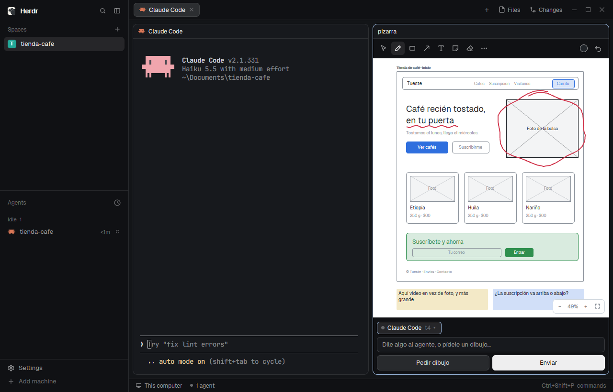
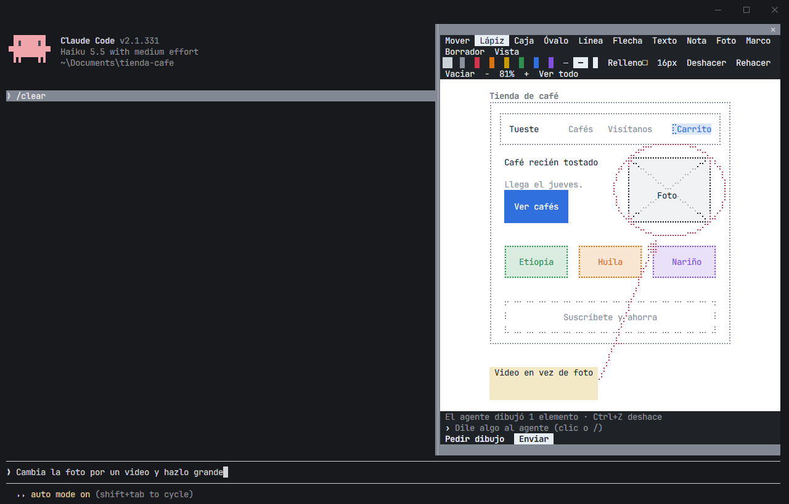
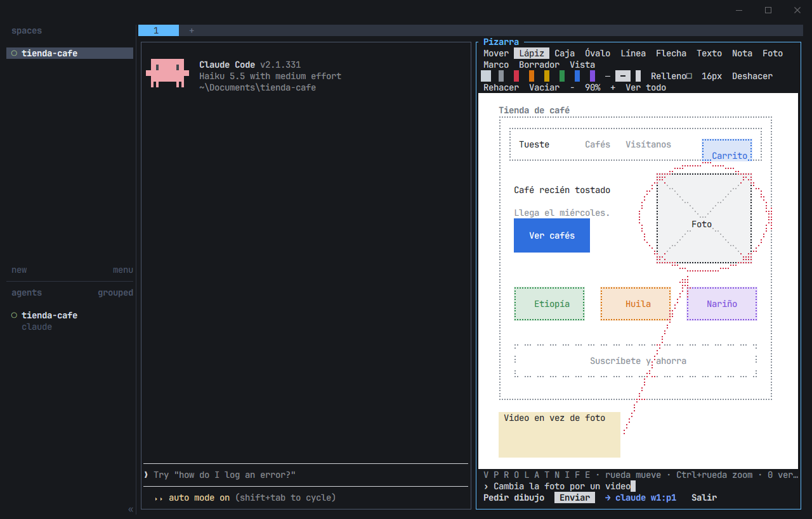
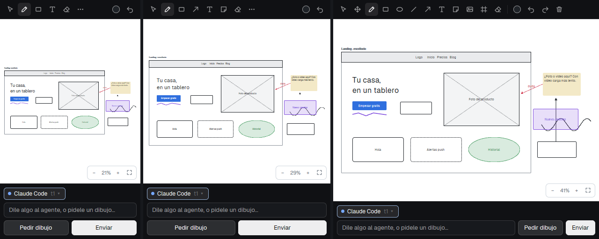

# Pizarra

A whiteboard beside your terminal. Draw a layout and send it to a coding agent, or ask the agent to
draw what it's going to build and correct it by hand before it writes code.



It comes in three forms that share one board per project (`.pizarra/board.json`):

| Where | Drawn with | Agents |
| --- | --- | --- |
| [Herdr](https://herdr.dev) desktop app (`herdr-app`) | native graphics | any agent in Herdr |
| Herdr terminal (`herdr`) | terminal cells | any agent in Herdr |
| Claude Code | terminal cells | that Claude session |

- White paper in every theme. Pen, shapes, arrows, text, notes, image placeholders and screens.
- The panel folds to the room it has.
- The agent gets a PNG, the scene as JSON, and the list of what you changed since its last drawing.
- What the agent draws shows within a second or so, highlighted, and Ctrl+Z undoes it. If you both
  change the board at once, both changes stay; on the same element yours wins.

| Claude Code | Herdr terminal |
| --- | --- |
|  |  |

The panel at 300, 400 and 570px wide in the desktop app:



All three need [Node](https://nodejs.org) 20 or newer on PATH. The interface is in Spanish.

## Install

**Claude Code**, at its prompt:

```
/plugin install pizarra --marketplace MarcozVD/herdr-pizarra
```

Answer `y` to add the marketplace and pick a scope. Then `/pizarron` opens the board.

**Herdr terminal:**

```
herdr plugin install MarcozVD/herdr-pizarra
```

Bind a key to it in Herdr's `config.toml`; with this one it's `ctrl+b`, then `i`:

```toml
[[keys.command]]
key = "prefix+i"
type = "plugin_action"
command = "marcozvd.pizarra.open"
description = "pizarra"
```

**Herdr desktop app:** copy `mods/pizarra/` and `mods/pizarra-panel/` into `~/.config/herdr-app/mods/`,
merge `keys.json` into yours, and copy `skills/pizarra/` into your agents' skills folder
(`~/.claude/skills/`, `~/.agents/skills/`). `ctrl-shift-d` opens and closes the board.
[RECIPE.md](RECIPE.md) is the brief to build the mod from scratch.

Any other terminal: `node mods/pizarra/tui.js` shows the board, and leaves the message in
`.pizarra/mensaje.md` for you to point your agent at.

## Keys

V select, H move the view, P pen, R rectangle, O ellipse, L line, A arrow, T text, N note, I image,
F screen, E eraser. Ctrl+Z / Ctrl+Y, Ctrl+D duplicate, Ctrl+A, Del, arrows nudge, `[` `]` order,
Enter edits the text, `0` fits (the selection, then everything), `1` real size, Ctrl+wheel zooms,
wheel or middle button pans. In the terminal forms `/` writes to the agent, Tab in a text starts a
new line, and Ctrl+Q closes the Herdr pane.

Where the terminal reports the mouse by cell, as Herdr's does, freehand lines come out stepped;
boxes, arrows and text are exact. Claude Code in Ghostty, kitty, WezTerm or iTerm2 draws smooth lines.

## What it touches

`.pizarra/` in the project, created on the first stroke with its own `.gitignore`. It runs `node` (its
own `cli.js`), and to send, `hc` or `herdr`, only to the agent you pick, when you press send. No
network. Agents on other machines aren't listed.

PNG rendering is [resvg-wasm](https://github.com/yisibl/resvg-js) 2.6.2 (MPL-2.0), in
`mods/pizarra/vendor`. The rest is [MIT](LICENSE).

`npm test` runs the tests; `claude plugin test .` runs the Claude Code ones.
