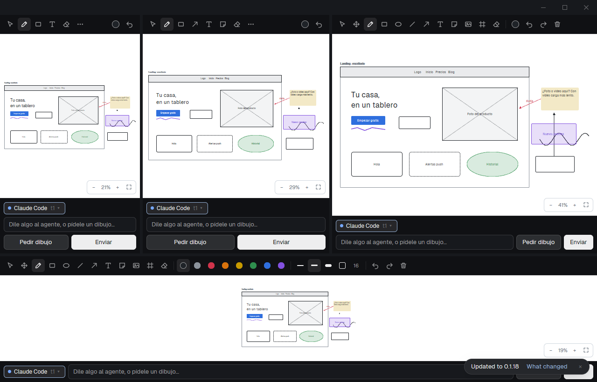

# Pizarra

A white board beside the terminal where a person draws a layout and sends it to an agent, and where the agent draws what it means to build so the person can correct it.

## What you see

Top to bottom, in the theme's `chrome` with 1px `border` lines:

1. **Bar**, 41px. Tools (28px buttons, 16px icons): select, hand, pen, rect, ellipse, line, arrow, text, note, image, frame, eraser. From 940px wide the styles sit in the same row: eight colors, three widths, fill, text size; then undo, redo, trash. Under 940px a round swatch opens the styles; under 560px only select, pen, rect, arrow, text, note, eraser, a `⋯` for the rest, the swatch and undo show; under 330px select, pen, rect, text and eraser. What opens floats over the paper, so the paper never moves under the pointer.
2. **Paper**, white in every theme, no grid. Ink colors: ink `#1f2328`, gray `#8b929b`, red `#d1344b`, orange `#d9730d`, yellow `#c79a00`, green `#2f8f4e`, blue `#2f6fde`, purple `#8250df`. Selection marks `#2f6fde`. Bottom right: `− 92% + ⛶`.
3. **Footer.** The agent it sends to, a status line, a text field, `Pedir dibujo` and `Enviar`. Under 440px tall it's one row; under 560px wide the buttons share a row of their own.

## How it behaves

- One board per space, `<space folder>/.pizarra/board.json`, created on the first stroke with a `.gitignore` of `*`.
- `Enviar` writes `mensaje.md` (image path, scene path, changes since the agents last saw it) and types one line into the agent. With a selection the person picked, only that is sent. `Pedir dibujo` asks for a drawing instead.
- An agent's change shows within a second, outlined for 5 seconds. It's one undo step. Both sides' changes merge by element id; on the same element the person's wins.
- The view refits only when something is out of sight or the panel grew, never during a gesture, and never after the person panned or zoomed, until `0`.
- A broken `board.json` is never overwritten: the footer says so and offers `Recuperar la mía`, which keeps it as `board.broken.json`.
- `ctrl-shift-d` opens the board right of the terminal, or closes it.

## Built from

- `mods/pizarra/`: `model.js` (elements, geometry, undo, merge, diff; pure), `main.js` (the view), `message.js`, `cli.js` (the agents' side: `guide`, `show`, `apply`, `set`, `rm`, `png`), `render.js` with resvg-wasm in `vendor/`, `where.js`. `term.js`, `tui.js`, `hash.js` and `herdr-open.js` are for the terminal forms.
- `mods/pizarra-panel/`: opens or closes the pane and goes away.
- Herdr functions: `agents`, `appHome`, `exec`, `focused`, `hc`, `nextCommand`, `notify`, `panes`, `props`, `readTextFile`, `run`, `settings`, `spaces`, `theme`, `window`, `writeTextFile`. Commands: `pane.split`, `pane.close`, `agent.focus`. Programs: `node`, `hc send`, `hc get`, `hc keys`.

## Watch out

- The global `window` (for `paint_path`) and `window()` from `herdr` clash: import the second under another name.
- `line_height(n)` with a number is a multiple of the text size.
- `herdr-app check` doesn't see errors in async code: look at the app's log.
- When a copy of a mod closes, another copy that's just starting can lose the calls it waits for. So the opener is a mod of its own, and a call that never returns is dropped after 4 seconds.
- Claude Code loses the Enter after a paste of several lines: type one line and put the rest in a file. `hc send --json` says `started: false` when that happens.
- `writeTextFile` doesn't make folders.
- Pointer positions are window px: divide by `settings().zoom`.

## Done when

- `npm test` passes, and `herdr-app check` on both mods.
- A stroke survives closing and reopening the panel.
- `node cli.js apply` on the open board shows within a second, outlined.
- After moving an agent's box, `Enviar` writes `~ changed rect <id>` in `mensaje.md`, and the agent starts without a key pressed.
- At 300, 400, 570 and 1280px wide, and 270px tall, no control is cut off.
